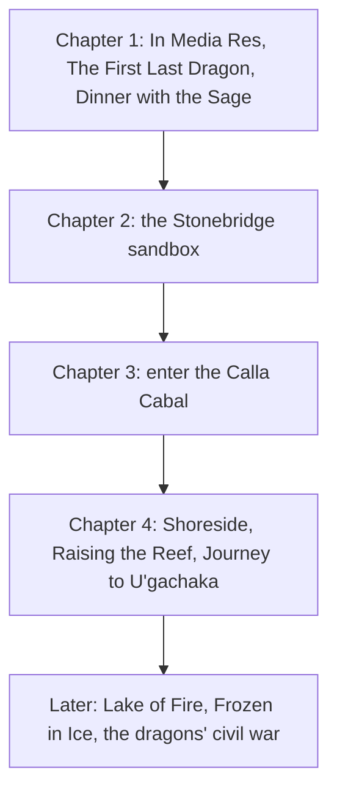

The general *intended* order of adventures. Players will be players.

## Chapter 1: Introductions

1. Start with [[In Media Res]], a tavern robbery that throws the party together.
2. Lead into [[The First Last Dragon]], where the party escorts a lone knight who shatters a statue.
3. Follow up with [[Dinner with the Sage]].

By the end, the party is somewhat familiar with the world and has a small hook into the main storyline.

## Chapter 2: Stonebridge

1. Introduce the shops and people of [[Stonebridge]]. They lead to many of the side quests (see [[Rumors and Hooks]]).
2. Consider events like [[The Party Returns]] and [[Fishy Business]].
3. Other side quests and events: [[Naiad of the Waterfall]], [[Dam the Dire Beavers]], [[Hunt for the Dire Bear]], [[Gordon's Dragon Experience]], [[Full Moon]], [[Modern Times Festival]].

## Chapter 3: The Cabal

> [!todo]
> How is the [[Calla Cabal]] introduced? See [[Open Questions]].

Candidates from the notes that involve the Cabal: [[Espionage]], [[Wagon Train Heist]], [[Royal Auction]].

## Chapter 4: To the Sea

1. Venture out to [[Shoreside]] and [[Dragon Reef]] ([[Raising the Reef]]).
2. Perhaps leading to a voyage: [[Journey to U'gachaka]].

## Later

- By the time of [[Frozen in Ice]], the party should have sided with the [[Order of the Orchid]] or the [[Calla Cabal]] ([[Faction Loyalty]]).
- [[Crossing the Lake of Fire]].
- The endgame: [[Fate of the Dragons]].

## Throughout

- [[We Meet Again]]: The Sage should reappear after every major dragon-related encounter.
- Road encounters like [[Elven Assassin]] and [[Guard Patrol]] fill the journeys between.
- Red herrings like [[Puppetmaster]] and [[The Excavation]] test whether the party can tell the real thing from a fake.
